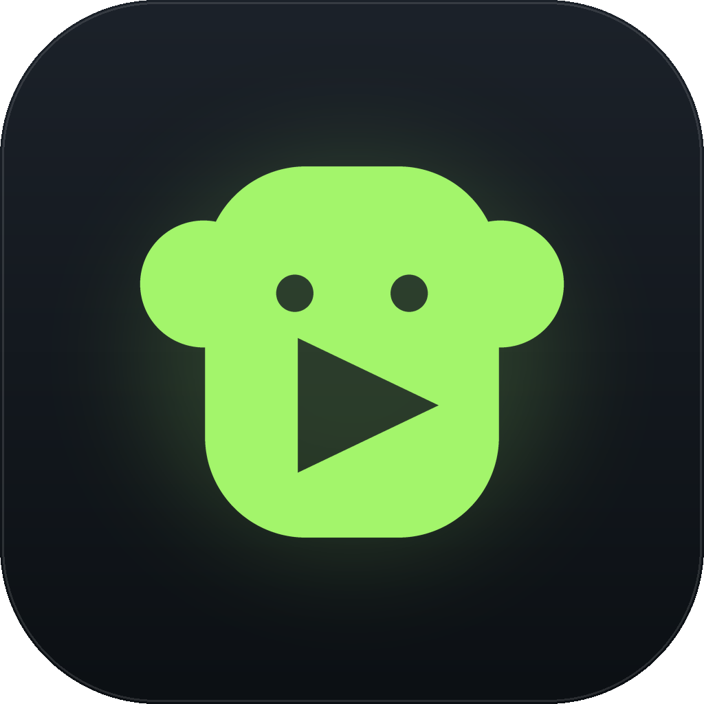
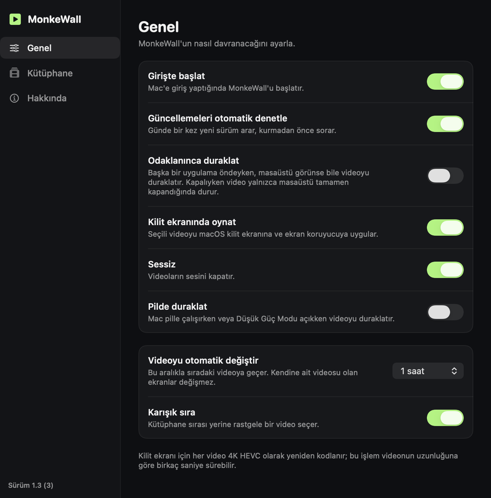
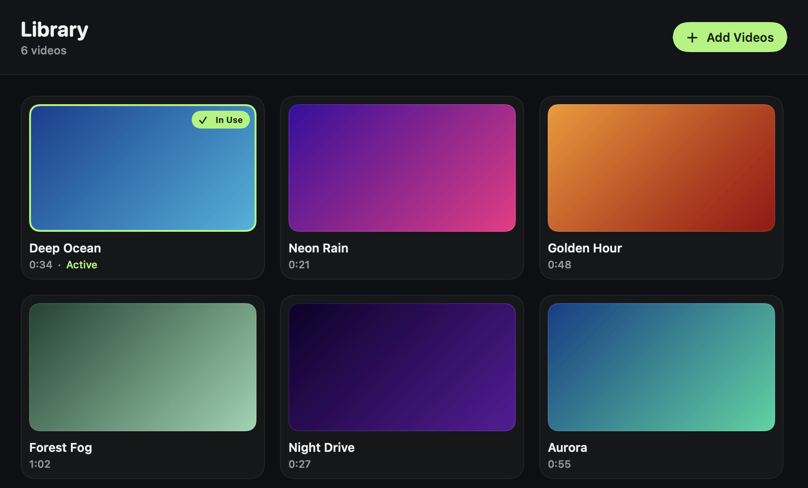
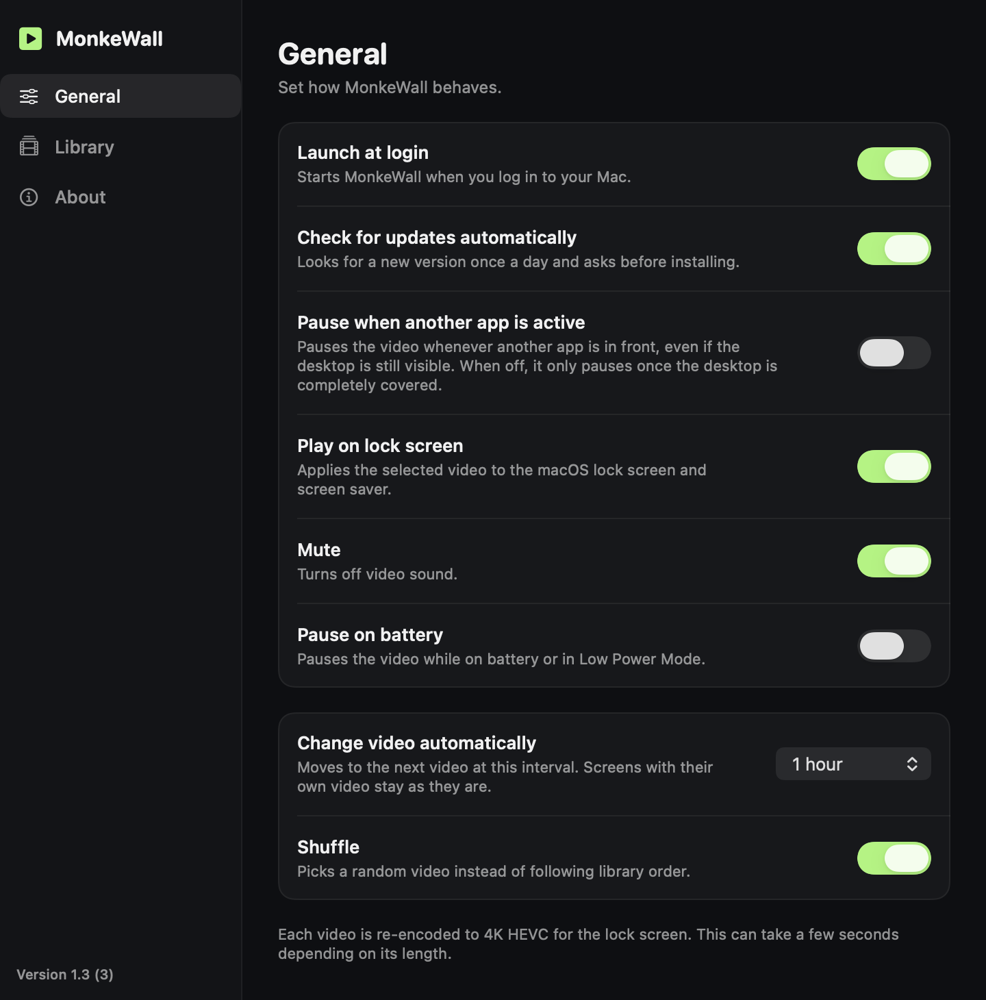

<p align="center">
  
</p>

<h1 align="center">MonkeWall</h1>

<p align="center">
  <strong>Your own video on the macOS desktop and lock screen.</strong>
</p>

<p align="center">
  
  
  
  
</p>

<details>
<summary><b>🇹🇷&nbsp; Türkçe</b> &nbsp;</summary>
<br>

macOS duvar kağıdı olarak yalnızca Apple'ın kendi aerial videolarını oynatır. MonkeWall sizinkini oynatır: bütün ekranların masaüstünde, kilit ekranında ve ekran koruyucuda. Menü çubuğunda durur, Dock'ta görünmez, başka bir şey kurmanızı istemez.

<p align="center">
  
</p>

## Ne yapar

- Herhangi bir videoyu bütün ekranların masaüstünde, simgelerin altında oynatır.
- Aynı videoyu kilit ekranında ve ekran koruyucuda da oynatır, uygulama kapalıyken bile.
- İsterseniz her ekrana ayrı video verir.
- Videoyu belirlediğiniz aralıkla değiştirir: sırayla ya da karışık, yumuşak geçişle.
- Gösterildiği masaüstleri tamamen kapanınca videoyu duraklatır. Ekran uyuyunca ya da Mac kilitlenince hepsi durur.
- İsterseniz pilde, Düşük Güç Modu'nda ya da başka bir uygulama öndeyken de duraklar.
- macOS dilinizi izler: Türkçe ya da İngilizce.
- Yeni sürüm çıkınca haber verir, onayınızla kendini günceller.

## Kurulum

Apple Silicon bir Mac'te macOS 13 veya üzeri gerekir.

1. [Releases](https://github.com/hootbu/MonkeWall/releases/latest) sayfasından zip dosyasını indirip açın.
2. `MonkeWall.app`'i Uygulamalar klasörüne taşıyın.
3. Açmayı deneyin. MonkeWall notarize olmadığı için macOS ilk açılışı engeller.
4. Sistem Ayarları > Gizlilik ve Güvenlik bölümünde **Yine de Aç** düğmesine basın.

Bu düğme çıkmazsa Terminal'de şunu çalıştırıp yeniden açın:

```bash
xattr -cr /Applications/MonkeWall.app
```

İlk açılışta kendini giriş öğelerine ekler, bunu Ayarlar'dan kapatabilirsiniz.

Kaynaktan derlemek isterseniz Xcode gerekir:

```bash
git clone https://github.com/hootbu/MonkeWall.git
cd MonkeWall
./build.sh
open MonkeWall.app
```

## Kullanım

Menü çubuğundaki maymuna tıklayıp **Kütüphane…** seçeneğini açın.

**Video eklemek için** videoları pencereye sürükleyin ya da **Video Ekle** düğmesine basın. İlk seferde kilit ekranında da oynatılıp oynatılmayacağı sorulur.

**Video seçmek için** kartına tıklayın. Video bütün ekranlarda ve kilit ekranında kullanılır, ekranlara özel seçimler sıfırlanır.

**Bir ekrana ayrı video vermek için** karta sağ tıklayıp **Şu Ekranda Kullan** menüsünden ekranı seçin. Aynı ekranı yeniden seçmek bunu geri alır. Bu menü birden fazla ekran varken görünür.

**Hızlıca değiştirmek için** kütüphaneyi açmadan menü çubuğundaki **Videolar** ya da **Sonraki Video** seçeneğini kullanın.

**Otomatik değiştirmek için** **Ayarlar…** içinde **Videoyu otomatik değiştir** aralığını seçin. Kendine ait videosu olan ekranlar değişmez.

<p align="center">
  
</p>

Yalnızca bu uygulamanın dilini değiştirmek için Sistem Ayarları > Genel > Dil ve Bölge > Uygulamalar bölümünü kullanın.

## Bilinmesi gerekenler

**Kilit ekranı kısmını Apple desteklemiyor.** macOS'ta bunun için bir API yok. MonkeWall videoyu macOS'un kendi duvar kağıdı dosyalarına kaydeder ve gerektiğinde WallpaperAgent'ı yeniden başlatır. Bu yüzden bir macOS güncellemesi bunu bozabilir, App Store'a da giremez. Güncellemeden sonra video kaybolursa menüden **Yeniden Yükle**'yi seçin. Sistem Ayarları'ndan başka bir duvar kağıdı seçerseniz MonkeWall buna karışmaz, **Yeniden Yükle** videoyu geri getirir.

**Önceki duvar kağıdınız saklanır.** İlk değişiklikten önce yedeklenir, kilit ekranını kapattığınızda ya da uygulamayı kaldırdığınızda geri gelir.

**Videolar yer kaplar.** Her video `~/Library/Application Support/MonkeWall` altına kopyalanır. Kilit ekranı için ayrıca dakikası 150 MB'a varan 4K HEVC bir kopya üretilir.

**İnternete yalnızca güncelleme için çıkar.** Günde bir kez GitHub'dan yeni sürüm var mı diye bakar, bunu Ayarlar'dan kapatabilirsiniz. Videolarınız Mac'inizden çıkmaz. Güncellemeler [Sparkle](https://sparkle-project.org) ile imzalı olarak gelir, indirilen dosyanın imzası tutmazsa kurulmaz.

## Kaldırma

**Ayarlar… > Hakkında > MonkeWall'u Kaldır…** önceki duvar kağıdınızı geri getirir, videoları ve ayarları siler, uygulamayı Çöp Kutusu'na taşır.

Kaynaktan derlediyseniz aynı temizliği terminalden de yapabilirsiniz, bu yol uygulamayı yerinde bırakır:

```bash
./uninstall.sh
```

<br>

<details>
<summary><b>Sorumluluk reddi</b></summary>
<br>

MonkeWall hobi amacıyla geliştirdiğim bir projedir. Apple ile herhangi bir bağlantısı ya da Apple tarafından verilmiş bir onayı yoktur. Apple'ın belgelemediği duvar kağıdı dosyalarını düzenlediği için kullanım riski size aittir. Eklediğiniz videoların sorumluluğu da size aittir.

</details>

## Lisans

© 2026 Emir Yorgun. Tüm hakları saklıdır. Ticari dağıtım için izin gerekir.

<hr>
</details>

macOS will only play Apple's own aerial videos as your wallpaper. MonkeWall plays yours: on the desktop of every screen, on the lock screen and in the screen saver. It lives in the menu bar, stays out of the Dock and asks you to install nothing else.

<p align="center">
  
</p>

## What it does

- Plays any video on the desktop of every screen, underneath your icons.
- Plays it on the lock screen and in the screen saver too, even while the app is closed.
- Gives each screen its own video if you want.
- Changes the video at an interval you pick, in order or shuffled, with a crossfade.
- Pauses a video once the desktops showing it are fully covered. Everything stops when the display sleeps or the Mac locks.
- Can also pause on battery, in Low Power Mode, or whenever another app is in front.
- Follows your macOS language: English or Turkish.
- Tells you when a new version is out and updates itself with your OK.

## Install

You need macOS 13 or later on Apple Silicon.

1. Download the zip from [Releases](https://github.com/hootbu/MonkeWall/releases/latest) and open it.
2. Move `MonkeWall.app` to your Applications folder.
3. Try to open it. MonkeWall isn't notarized, so macOS blocks the first launch.
4. Go to System Settings > Privacy & Security and click **Open Anyway**.

If that button doesn't appear, run this in Terminal and open it again:

```bash
xattr -cr /Applications/MonkeWall.app
```

It adds itself to your login items on first launch. You can turn that off in Settings.

To build from source, you need Xcode:

```bash
git clone https://github.com/hootbu/MonkeWall.git
cd MonkeWall
./build.sh
open MonkeWall.app
```

## Using it

Click the monkey in the menu bar and open **Library…**.

**To add videos,** drag them into the window or click **Add Videos**. The first time, MonkeWall asks whether the lock screen should play them too.

**To pick a video,** click its card. It goes on every screen and the lock screen, and any per-screen picks are cleared.

**To give a screen its own video,** right-click a card and choose the screen under **Use on Screen**. Choosing the same screen again undoes it. This menu appears when more than one screen is connected.

**To switch quickly,** use **Videos** or **Next Video** in the menu bar, without opening the library.

**To change videos automatically,** open **Settings…** and pick an interval for **Change video automatically**. Screens with their own video stay as they are.

<p align="center">
  
</p>

To change the language for this app alone, use System Settings > General > Language & Region > Applications.

## Good to know

**Apple doesn't support the lock screen part.** macOS has no API for it. MonkeWall registers the video in macOS's own wallpaper files and restarts WallpaperAgent when it has to, so a macOS update can break it, and it can't go on the App Store. If the video disappears after an update, choose **Reload** from the menu. If you pick another wallpaper in System Settings, MonkeWall leaves it alone, and **Reload** brings the video back.

**Your previous wallpaper is kept.** It's backed up before the first change and comes back when you turn the lock screen off or uninstall.

**Videos take up space.** Each one is copied into `~/Library/Application Support/MonkeWall`, and the lock screen gets its own 4K HEVC copy of up to 150 MB per minute of video.

**It only goes online for updates.** Once a day it asks GitHub whether there's a new version, and you can turn that off in Settings. Your videos never leave your Mac. Updates arrive signed through [Sparkle](https://sparkle-project.org), and a download whose signature doesn't match won't install.

## Uninstall

**Settings… > About > Uninstall MonkeWall…** brings your previous wallpaper back, deletes the videos and settings, and moves the app to the Trash.

If you built from source, you can do the same cleanup from the terminal, which leaves the app where it is:

```bash
./uninstall.sh
```

<br>

<details>
<summary><b>Disclaimer</b></summary>
<br>

MonkeWall is a hobby project. It has no connection to Apple and carries no endorsement from them. It edits wallpaper files Apple doesn't document, so use it at your own risk. You are responsible for the videos you add.

</details>

## License

© 2026 Emir Yorgun. All rights reserved. Commercial distribution requires permission.
